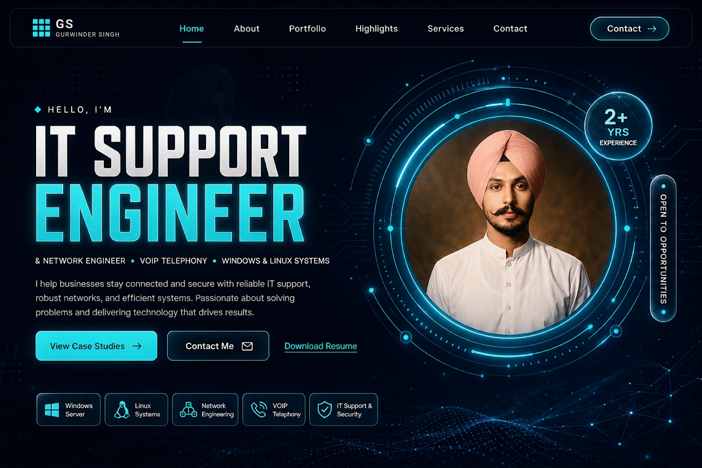
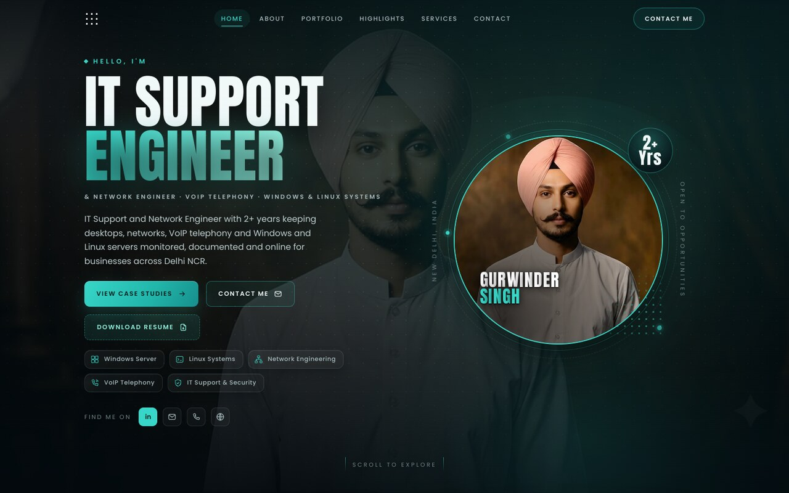

# Hero design brief — build prompt and art prompt

Two copies of the same idea: one is the brief an AI builder (v0, Lovable, Claude
Artifacts, Cursor) needs to produce the hero section, and one is the prompt an image
model (Midjourney, Ideogram, DALL·E) needs to produce the mockup. Both are written
against the finished hero in `index.html`, so what they describe is what the site
actually renders.

| | Use it for | Output |
|---|---|---|
| [Prompt 1 — UI build](#prompt-1--ui-build) | v0 · Lovable · Claude Artifacts · Cursor | Working hero section, React + Tailwind or vanilla |
| [Prompt 2 — Concept art](#prompt-2--concept-art) | Midjourney · Ideogram · DALL·E · Firefly | One 16:9 landing-page mockup |

*The concept mockup — one 16:9 frame generated from Prompt 2.*

*The shipped hero — `index.html` in a 1440 px viewport, i.e. the same design built for
real in HTML and CSS.*

---

## Prompt 1 — UI build

Paste this as-is into a builder that writes HTML/React. The section at the end tells
the model what to do about the stack.

> **Role:** senior front-end engineer and product designer.
>
> **Task:** build the hero section of a one-page portfolio for an IT Support &
> Network Engineer. Dark, technical, enterprise-calm — closer to a network operations
> dashboard than to a personal blog.
>
> **Stack:** React 18 + Tailwind CSS + `lucide-react`. No UI kit, no component
> library, no animation library — CSS transitions and keyframes only. If the target
> cannot take React, emit the same design as semantic HTML plus a single plain CSS
> file with custom properties for every colour; do not reach for a framework.
>
> **Navbar**
> - Fixed, 68 px tall, transparent at the top of the page; on scroll it gains
>   `rgba(5,12,16,.82)` plus a 14 px backdrop blur and a 1 px hairline underneath.
> - Left: 26 × 26 px dot-matrix logo mark (a 9 px radial-gradient grid), plus an
>   accessible name for screen readers.
> - Centre: Home · About · Portfolio · Highlights · Services · Contact, 12 px
>   uppercase, 0.14 em tracking. The active link gets a soft cyan wash and a short
>   underline; a scroll spy keeps it in sync.
> - Right: **Contact Me**, a pill (`border-radius: 999px`), 1 px cyan-tinted border,
>   transparent fill. Below 820 px the links collapse into a full-width panel behind
>   a hamburger, and the pill is hidden.
>
> **Hero copy (left column)**
> - Eyebrow: a small cyan diamond followed by `HELLO, I'M`, 12 px, 0.34 em tracking.
> - Headline: `IT SUPPORT` on one line in near-white, `ENGINEER` on the next in a
>   cyan gradient (`#38d6c8 → #91f0df`) with a soft 24 px glow. A condensed display
>   face (Anton or equivalent), 3.1–6.6 rem via `clamp()`, 0.94 line-height,
>   uppercase.
> - Role line: `& NETWORK ENGINEER · VOIP TELEPHONY · WINDOWS & LINUX SYSTEMS`,
>   11 px, 0.24 em tracking, muted.
> - Lead paragraph, max 44 ch: *"IT Support and Network Engineer with 2+ years keeping
>   desktops, networks, VoIP telephony and Windows and Linux servers monitored,
>   documented and online for businesses across Delhi NCR."*
> - Actions, in this order: solid cyan **View Case Studies →**; outlined
>   **Contact Me ✉**; dashed, lower-emphasis **Download Resume** (a real PDF
>   download). All three use a 10 px radius, uppercase 11.5 px labels, and a circular
>   reveal that grows from the pointer on hover (skip it on touch).
> - Toolset strip under the buttons — five 34 px bordered tiles with a 16 px icon each:
>   Windows Server · Linux Systems · Network Engineering · VoIP Telephony ·
>   IT Support & Security. Wraps to two rows below ~620 px.
> - Footer row: `FIND ME ON` and four 34 px social squares (LinkedIn, email, phone,
>   website).
>
> **Portrait (right column)**
> - A 404 px circle (min of 82 vw on small screens) holding the headshot with
>   `object-position: 50% 22%`, a 2 px cyan rim, and a wide soft shadow.
> - Around it, in order: a 1 px cyan ring; a 1 px dashed ring 16 px outside that
>   rotates once every 46 s; a masked `repeating-conic-gradient` tick band 34 px out
>   (0.45° dashes every 4°, masked to a thin annulus, 0.5 opacity, spinning the other
>   way over 140 s); three pulsing telemetry nodes on the orbit, 9 px, cyan with a
>   4 px translucent halo.
> - The name sits over the lower-left of the photo: `GURWINDER` in white, `SINGH` in
>   cyan, over a dark radial scrim so it stays legible on any frame.
> - A 130 px dot-matrix patch fades in at the lower right of the ring.
> - Floating glass badge at the ring's top right: `2+` over `Yrs`, 0.205 × ring
>   diameter, `blur(10px)` fill, cyan hairline, inner highlight.
> - Vertical micro-labels on both edges: `NEW DELHI, INDIA` on the left,
>   `OPEN TO OPPORTUNITIES` on the right; 10.5 px, 0.4 em, muted. Hide the tags below
>   560 px.
>
> **Background**
> - Base `#050c10`, never `#000`. A single radial bloom (`rgba(56,214,200,.13)` →
>   transparent at 69 %) sits behind the portrait at `top: 7%; right: -8%`, up to
>   980 px across.
> - Fine dot grid at ~10 % opacity; optional very low-opacity silhouette of the same
>   portrait for depth. Nothing that competes with body copy.
> - Section is `isolation: isolate; overflow: clip` so the bloom never creates a
>   horizontal scrollbar.
>
> **Motion** — every reveal is opacity + 26 px translate over 0.7 s with a stagger of
> ~80 ms; rings rotate slowly; nodes pulse on a 4.2 s loop; the portrait name performs
> a per-character colour sweep once, on first view. All of it is gated behind
> `prefers-reduced-motion: reduce`, and hover motion is gated behind
> `(hover: hover)`.
>
> **Quality bar**
> - 4.5:1 minimum contrast for body copy against the *composited* background, not the
>   base colour — the bloom and photo both sit behind text.
> - Breakpoints at 1080 / 980 / 820 / 560 / 430 px. At 980 the layout becomes one
>   column with the portrait first.
> - No horizontal overflow at any width; the page must not scroll sideways at 360 px.
> - Real `<a>` elements for every action, SVG icons with `aria-hidden`, visible focus
>   rings, and no icon font.

**What this repository already implements.** The hero in `index.html` is this brief in
vanilla HTML/CSS: `.hero`, `.hero__title`, `.hero__tools`, `.portrait__ring`,
`.portrait__ticks`, `.portrait__year`, `.portrait__tag` in `css/styles.css`. The stack
line in the prompt is the part to change if you are generating instead of editing —
this repo has no build step and no dependencies.

---

## Prompt 2 — Concept art

For Midjourney add `--ar 16:9 --style raw --v 6` (or the current default); for
Ideogram, set the aspect to 16:9 and use the "Design" style; for DALL·E, ask for a
wide composition in the prompt itself.

> UI/UX website landing-page mockup, hero section for an IT systems and network
> engineer's portfolio. Deep navy `#0A0F1D` canvas with soft cyan (`#38D6C8`) glow,
> faint telemetry grid and circuit traces, generous negative space.
>
> Left: a small diamond bullet and the words **HELLO, I'M**; a huge bold condensed
> sans-serif headline **IT SUPPORT ENGINEER**, second line in glowing cyan; a thin
> uppercase sub-line reading **& NETWORK ENGINEER • VOIP TELEPHONY • WINDOWS & LINUX
> SYSTEMS**; a short grey bio paragraph; three pill buttons — solid cyan *View Case
> Studies →*, outlined *Contact Me ✉*, quiet text link *Download Resume* — and a row
> of five small bordered capability tiles beneath them.
>
> Right: a large illuminated circular portrait frame with concentric neon-cyan data
> rings, tick marks and orbit dots, containing a professional headshot of a young
> Indian Sikh engineer wearing a pastel-pink turban and a white mandarin-collar shirt,
> calm confident expression. A glassy round *2+ YRS EXPERIENCE* badge floats at the
> ring's top right; a vertical pill reading *OPEN TO OPPORTUNITIES* runs down the
> outer edge.
>
> Top: a sleek dark navigation bar with a grid-square logo, links Home · About ·
> Portfolio · Highlights · Services · Contact, and a pill-shaped Contact button at the
> right.
>
> Enterprise dashboard aesthetic, high-contrast typography, ultra-clean modern web
> interface, pixel-sharp UI, 8k, Dribbble showcase presentation.

**Negative prompt** (Midjourney `--no`, Ideogram negative field):
`blurry text, garbled lettering, mojibake, watermark, extra fingers, distorted face,
busy background, rainbow colours, cluttered layout, drop shadows everywhere,
low-contrast grey text`.

**Typography warning.** Image models still misspell long headlines; generate the
layout first, then set the real type over it. The mockup in this folder
([hero-concept.png](hero-concept.png)) needed one correction pass for the logo
wordmark.
